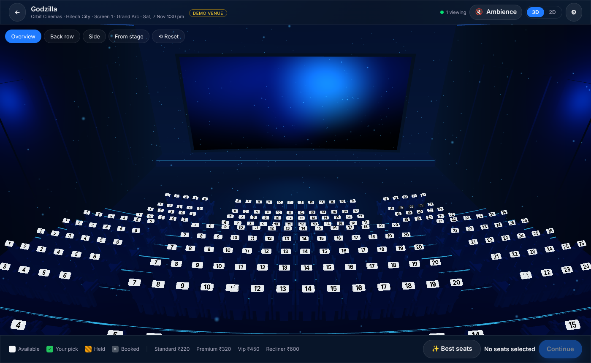
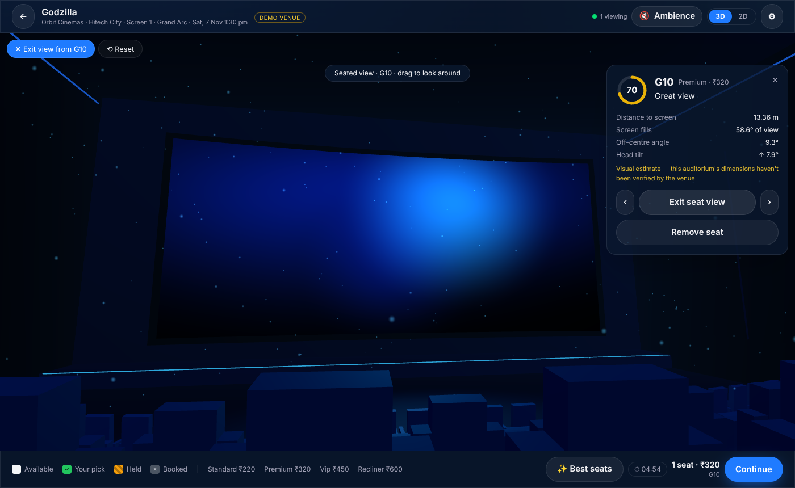
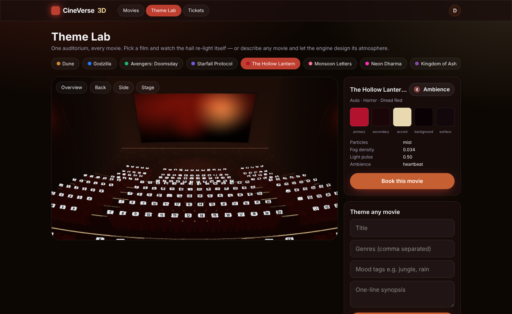
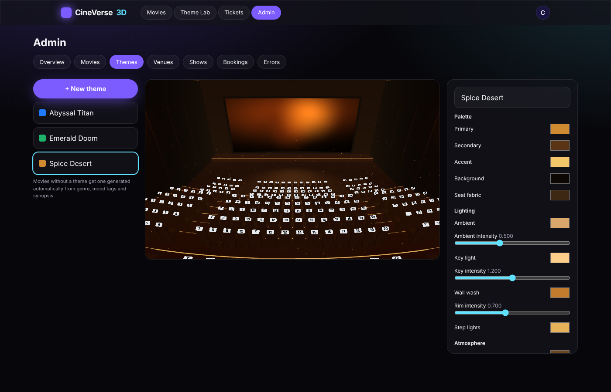

# CineVerse 3D

Movie-ticket booking inside an interactive 3D auditorium that re-lights itself for every film.

* **Web, Android, iOS from one codebase** - Next.js static export, packaged with Capacitor.
* **Real 3D theatre** - instanced seats built from the venue's actual layout, curved screen, stadium risers,
  aisle lighting, multiple camera viewpoints, touch + mouse controls.
* **View From My Seat** - drops the camera to seated eye level and reports distance, how much of your view
  the screen fills, off-centre angle and head tilt. Labelled as an estimate unless the venue's dimensions are verified.
* **Dynamic Movie Theme Engine** - works for *any* movie. Admin-authored themes win; otherwise the engine
  scores 15 visual archetypes against genre/mood tags/synopsis, blends the top two, bends towards key-art
  colours, and falls back to a title-derived palette. Themes crossfade - Dune to Godzilla eases from
  amber to abyssal blue in the same hall.
* **Booking engine that doesn't double-book** - Redis Lua holds (all-or-nothing, 5-minute window that never
  extends), a Postgres partial unique index as the last line of defence, idempotent payment confirmation,
  replay-safe webhooks, late-payment recovery/refund flagging, automatic expiry.
* **Live** - WebSockets (fanned out via Redis pub/sub) keep every viewer's 2D and 3D maps in sync.
* **Smart seat recommendations** - geometry-based scoring + contiguous group search with budget filter.
* **Accessible** - full 2D seat map with keyboard navigation and screen-reader labels, status shown by
  pattern/symbol not just colour, high-contrast + reduced-motion modes, automatic 2D fallback when WebGL is
  missing or the device is too slow.
* **Original ambience** - every sound is synthesised live with Web Audio. Muted by default.

> All theatres in the seed data are fictional demo venues with simulated inventory, and the UI says so.
> Payments run in sandbox mode (a local simulator, or Razorpay **test** keys). Nothing here sells real tickets.

## Screens

| 3D auditorium (Godzilla theme) | View From My Seat |
|---|---|
|  |  |
| **Theme crossfade mid-transition (Dune -> horror)** | **Admin theme editor with live preview** |
|  |  |

Mobile: [3D on a Pixel 7](docs/screenshots/mobile3d.png) · Accessible [2D map](docs/screenshots/map2d.png) · [Home](docs/screenshots/home.png)

## Quick start (Docker)

```bash
docker compose up --build
```

Web: http://localhost:3000 · API docs: http://localhost:8000/api/docs

Logins: `demo@cineverse.dev / Demo@1234` and admin `admin@cineverse.dev / Admin@123`.

## Local development

Requirements: Python 3.12+, Node 22, PostgreSQL 16, Redis 7.

```bash
cd backend
python -m venv .venv && . .venv/bin/activate
pip install -r requirements-dev.txt
cp .env.example .env            # adjust DB/Redis URLs
alembic upgrade head
python -m app.seed               # --reset to wipe and reseed
uvicorn app.main:app --reload --port 8000
```

```bash
cd frontend
npm install
npm run dev                      # http://localhost:3000
```

## Tests

```bash
cd backend && python -m pytest -q          # 68 tests: unit, integration, concurrency, payments, live websockets
cd frontend && npx vitest run              # theme transitions, geometry, seat-state logic
cd frontend && npx playwright test --trace off   # e2e on desktop + Pixel 7 (needs API + built site, see docs/TESTING.md)
```

## Documentation

| Doc | What's inside |
|---|---|
| [docs/ARCHITECTURE.md](docs/ARCHITECTURE.md) | System design, folder structure, DB schema, theme engine, 3D implementation, UI components |
| [docs/API.md](docs/API.md) | Every endpoint + WebSocket protocol |
| [docs/FLOWS.md](docs/FLOWS.md) | Reservation, payment and expiry sequence diagrams |
| [docs/TESTING.md](docs/TESTING.md) | Test strategy and how to run each layer |
| [docs/DEPLOYMENT.md](docs/DEPLOYMENT.md) | Docker, production settings, Razorpay test mode, Android/iOS with Capacitor |
| [docs/IMPLEMENTATION_GUIDE.md](docs/IMPLEMENTATION_GUIDE.md) | Phase-by-phase build guide and what's next |
