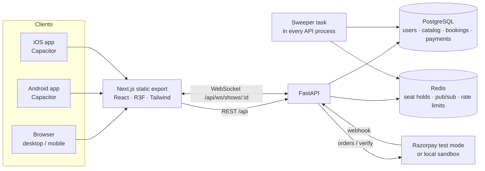
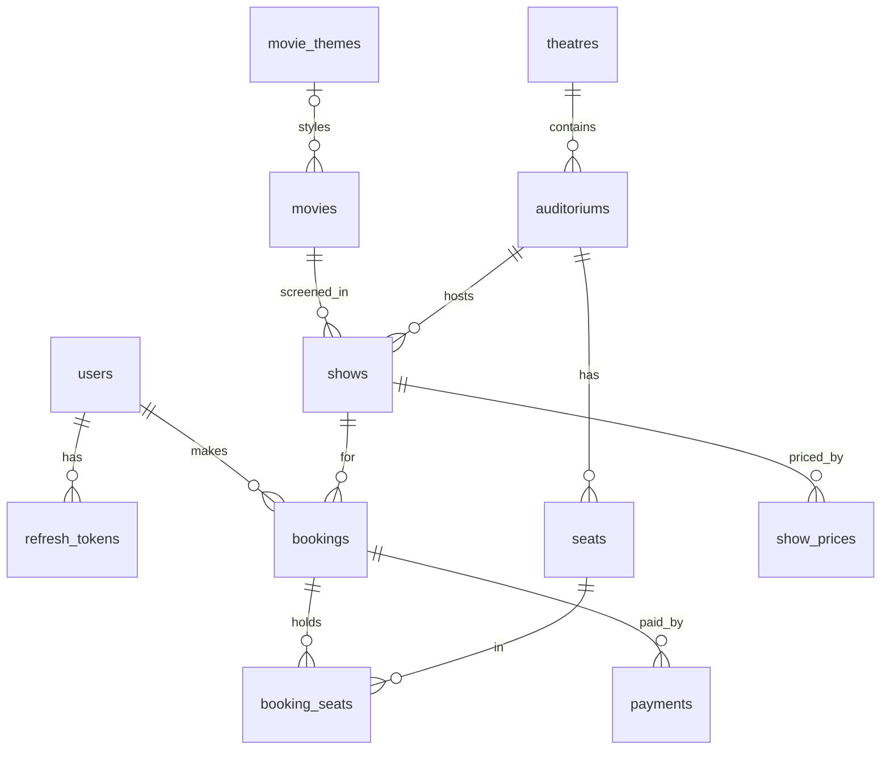
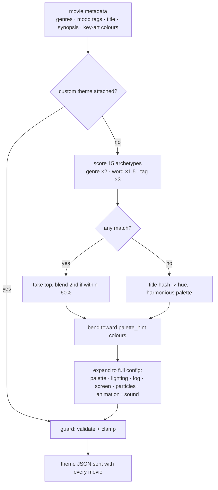

# Architecture



* The frontend is a **static export** - no Node server in production. The same `out/` folder is served by
  nginx and bundled into the Android/iOS shells. Dynamic ids travel in query strings (`/seats/?show=…`)
  so every route can be pre-rendered.
* The backend is **stateless**. Seat holds live in Redis, confirmed seats in Postgres, and seat changes are
  published to Redis so any number of API processes can serve WebSocket clients.
* A small sweeper loop (every 2 s) announces expired holds and expires unpaid bookings. It uses
  `FOR UPDATE SKIP LOCKED`, so running it in several processes is safe.

## Folder structure

```
backend/
  app/
    main.py                 app factory, middleware (request id, error log), lifespan (hub + sweeper)
    seed.py                 demo data: themes, 13 movies, 6 venues, 3 layouts, a week of shows
    core/                   config, security (argon2, JWT, HMAC), redis, rate limit, errors
    db/                     async engine/session, declarative base with naming conventions
    models/entities.py      SQLAlchemy models
    schemas/api.py          Pydantic request models + validation
    api/deps.py             DB / auth / admin / hold-store dependencies
    api/serializers.py      response shaping
    api/routes/             auth, catalog, seats (+ websocket), bookings, payments, admin
    services/
      layout.py             authored layout -> seat coordinates (arcs, aisles, risers)
      viewing.py            view metrics + group recommendations
      theme_engine.py       dynamic movie theme engine
      holds.py              Redis Lua seat holds
      bookings.py           booking lifecycle (create / confirm / release / expire)
      payments.py           mock + Razorpay providers
      seatmap.py            seat state snapshot
      events.py             Redis pub/sub -> websocket hub
      sweeper.py            hold + booking expiry loop
  alembic/                  migrations
  tests/                    pytest suites

frontend/
  src/app/                  routes: / (splash) login register home movie showtimes seats checkout ticket profile lab admin
  src/components/
    theatre/                the 3D auditorium (see below)
    seats/                  2D map, legend, hold timer, seat view panel, recommendations
    admin/                  dashboard tabs
    ui/                     shell, poster art, toasts, theme applier, sound control
  src/lib/                  api client, auth/prefs/seat stores, theme helpers, ambience synth, webgl detection
  e2e/                      Playwright specs
  capacitor.config.ts
```

## Database



Key constraints:

| Table | Constraint | Why |
|---|---|---|
| `booking_seats` | `UNIQUE (show_id, seat_id) WHERE active` | No two live bookings can ever own a seat - enforced by Postgres even if app code or Redis misbehaves |
| `payments` | `UNIQUE provider_order_id`, `UNIQUE provider_payment_id` | One order per attempt; a payment id can't confirm two bookings |
| `webhook_events` | PK = provider event id | Replayed webhooks become no-ops |
| `seats` | `UNIQUE (auditorium_id, label)` | Seat labels are stable identifiers |
| `auditoriums` | `UNIQUE (theatre_id, name)` | |

Money is stored in paise (integers). Seats carry real-world coordinates in metres (`x` across, `y` floor height,
`z` distance from the screen plane, `yaw` rotation) computed once from the layout.

## Auditorium layout format

```json
{
  "screen": {"width": 15, "height": 6.4, "curvature": 0.22, "distance": 7, "bottom": 1.5},
  "aisle_width": 1.3, "arc_focus": 24, "rise_per_row": 0.34, "flat_rows": 2,
  "rows": [
    {"label": "A", "category": "standard", "blocks": [5, 12, 5]},
    {"label": "L", "category": "recliner", "blocks": [3, 8, 3], "accessible": [1, 14], "blocked": [], "gap_before": 0.4}
  ]
}
```

`blocks` are seat counts per section; gaps between blocks become aisles (and empty columns in the 2D grid).
`arc_focus > 0` bends rows into arcs around a point behind the screen, rotating seats to face the centre.
Seat width and row pitch depend on category. `layout.py` validates and expands this into seats.

## Dynamic Movie Theme Engine



Archetypes: desert, ocean, cosmic, tech, neon, horror, inferno, frost, jungle, noir, romance, whimsy, royal,
period, arena. Adding one is a dictionary entry.

`guard()` is the safety net for both auto and admin themes: backgrounds stay dark, light colours stay bright
enough to light anything, ambient intensity/fog/particle density are capped (back rows stay visible, phones
stay cool), unknown particle or sound presets fall back. **Seat status colours are not part of a theme** - they
are fixed and drawn unlit, so availability reads the same under every film.

On the client, `ThemeState` keeps the *displayed* values and eases toward the target every frame
(`1 - e^(-k·dt)`, with k from `transition_ms`). Lights, fog, screen shader, wall strips, seat fabric and
particles all read from it, so a theme switch is a crossfade with no React re-render and no scene rebuild.
Particles fade out, swap type, and fade back in. CSS custom properties are registered with `@property`
so the 2D UI shifts colour smoothly too.

## 3D auditorium implementation

| Piece | How | Cost |
|---|---|---|
| Seats | one `InstancedMesh` per category (4 low-poly merged models) | 4 draw calls for any hall size |
| Number plates | one `InstancedMesh` + custom shader: status colour + seat number from a canvas atlas, unlit, fog-free | 1 draw call |
| Risers | per-row extruded arc slabs merged into one geometry, glowing nosing merged into another | 2 draw calls |
| Walls, panels, light strips | boxes + instanced panels; emissive materials driven by theme | ~12 |
| Screen | curved plane, shader with slow original gradient loop | 1 |
| Particles | one `Points`, all motion in the vertex shader, 12 kinds | 1 |
| Lighting | ambient + hemisphere + key + 2 rim + screen spot; **no realtime shadows** | |

* Picking uses R3F raycasting on instanced meshes (`instanceId` -> seat); drags > 8 px aren't clicks.
* Cameras: drei `CameraControls` with smooth transitions. Viewpoints: overview, back row, side, from stage,
  and seat view (eye height 1.15 m above the row floor, look-around limited to ±70°, zoom/pan disabled,
  plates hidden so they don't block the screen).
* Performance: `detectGpu()` picks low/high quality (DPR, antialias, particle count); drei
  `PerformanceMonitor` lowers DPR when FPS drops and, if it keeps dropping, offers the 2D map. No WebGL ->
  2D only. The 3D bundle is lazy-loaded (`next/dynamic`, `ssr:false`), so the 2D path never downloads three.js.
* Reduced motion: instant theme switches, no particles, no light pulse, camera jumps instead of flying.

## Booking states

| UI state | Source |
|---|---|
| Available | not blocked, no live booking row, no Redis hold |
| Selected | Redis hold whose tag = my tag |
| Held | someone else's Redis hold, or a `PENDING_PAYMENT` booking |
| Booked | `CONFIRMED` booking |
| Blocked | `seats.is_blocked` |

The hold "tag" is an HMAC of the user id, so clients can tell "mine" from "theirs" without learning user ids.

## UI component map

* `AppShell` - header/bottom nav, auth + prefs hydration, skip link, toasts
* `ThemeApplier` - pushes a movie's palette into CSS variables
* `PosterArt` - generated SVG key art from theme + title hash (no copyrighted posters)
* `SeatMap2D` - accessible grid, roving tabindex, arrow-key navigation, symbols + patterns per state
* `Auditorium3D` -> `Lights`, `Room`, `Screen`, `Seats`, `Particles`, `CameraRig`
* `SeatViewPanel` - score ring, view metrics, estimate label, prev/next seat, select/remove
* `Recommendations` - group size + budget -> ranked options with preview / pick
* `HoldTimer`, `Legend`, `SoundControl`
* Admin: `Overview`, `Movies`, `Themes` (live 3D preview), `Venues` (layout JSON + top-down preview),
  `Shows`, `Bookings` (+ QR check-in), `Errors`
