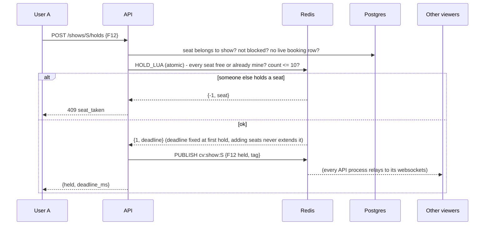
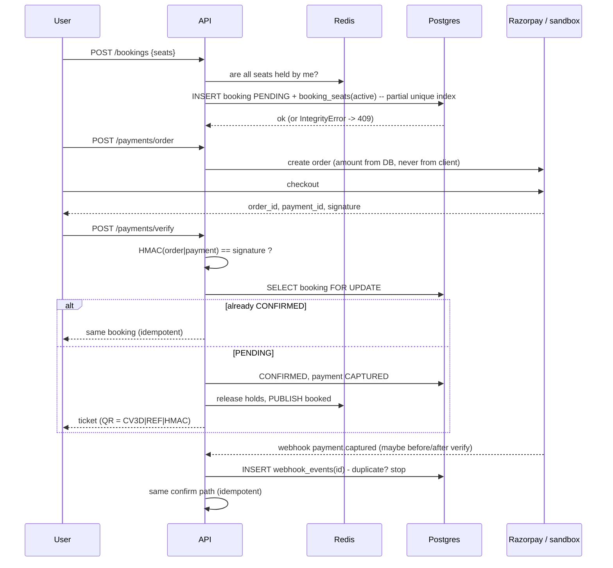
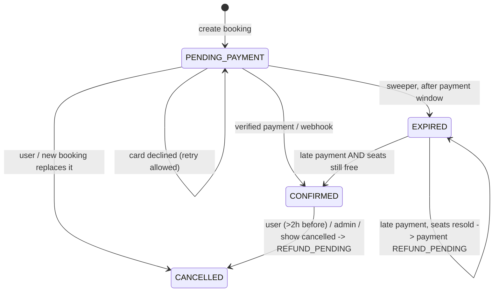

# Reservation & payment flows

## Selecting seats (hold)

## Booking + payment

## Failure & expiry paths

* **Abandoned selection** - Redis key TTL ends the hold; the sweeper sees it in the expiry zset and broadcasts
  `available` (unless a pending booking still covers the seat).
* **Abandoned checkout** - `expires_at` passes; sweeper flips to `EXPIRED`, deactivates `booking_seats`, broadcasts.
* **Two people, one seat** - Redis Lua is atomic, so exactly one hold wins. If a bug ever skipped Redis, the
  partial unique index still lets only one booking row become live (both are covered by tests).
* **Double click / retries** - order creation reuses the open order; verify and webhooks are idempotent.
